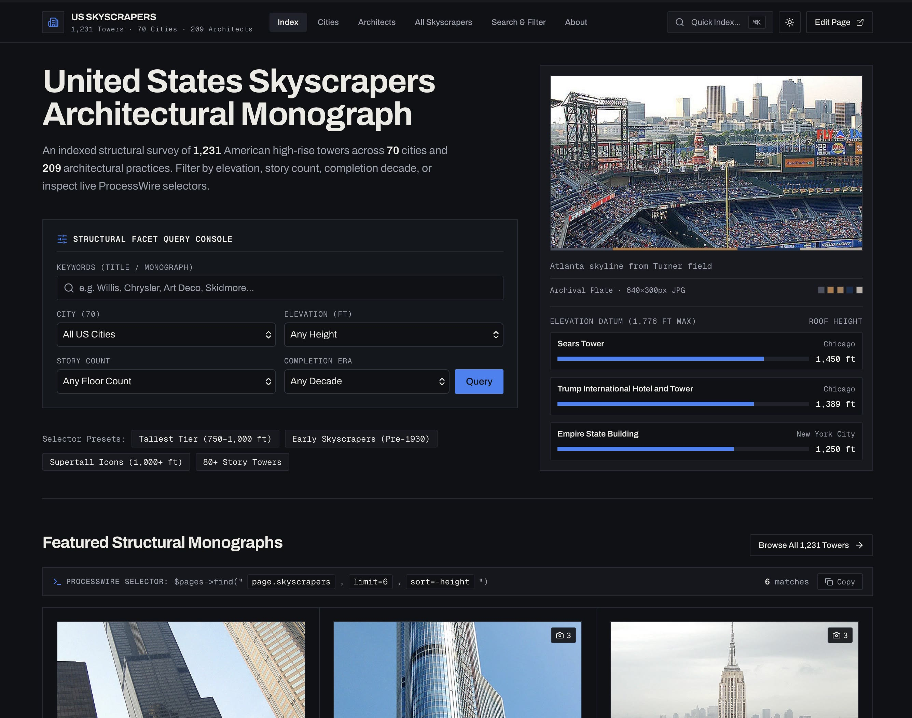

# ProcessWire React Skyscrapers Profile (`site-react-skyscrapers`)

A modern Single-Page Application (SPA) edition of the classic **United States Skyscrapers** site profile for ProcessWire 3—powered by **ProcessWire Custom Page Classes**, **Inertia.js v3**, **React 19**, **Vite 8**, **Tailwind CSS v4**, **Leaflet** interactive mapping, and **InterventionImage** with automated WebP `srcset`, Low-Quality Image Placeholders (LQIP), and Vibrant/Muted color palette extraction.



---

## Highlights

- **Zero-Controller Boilerplate via `InteractWithInertia`:** All 9 frontend templates (`home`, `cities`, `city`, `skyscraper`, `architects`, `architect`, `list-all`, `search`, `basic-page`) map to strongly-typed Custom Page Classes in `site/classes/` extending `DefaultPage`. Every template file in `site/templates/*.php` is a single `$page->inertiaRender('...')` call.
- **Inertia.js v3 Protocol Features:** Uses cross-visit cached `OnceProp` (`->once()->as('...')->until(3600)`) paired with ProcessWire `WireCache` for the 70-city and 209-architect directories, keeping subsequent SPA transitions near-instant.
- **Tiered `DataProvider` Pipeline:** Custom `CityTemplateDataProvider`, `SkyscraperTemplateDataProvider`, and `MapMarkerFieldDataProvider` in `site/inertia/` serialize ProcessWire pages and fields into clean, end-to-end TypeScript-typed props (`site/templates/assets/js/types/inertia.d.ts`).
- **Next-Gen Archival Photography (`InterventionImage`):** Automatically generates responsive WebP `srcset` variations, base64 WebP LQIP blur-up placeholders, dominant hex colors, 5-swatch palettes, Vibrant/Muted color themes, and perceptual `dhash` hashes.
- **Interactive Selector Inspector & Command Palette (`⌘K`):** Every view exposes the exact ProcessWire selector string powering the page (`template=skyscraper, parent=/cities/chicago/, height>=750, sort=-height`) alongside equivalent PHP API and CLI snippets with one-click copy.
- **Works Out of the Box:** Pre-built production assets (`site/templates/build/`) are bundled directly in the profile—no `npm install` or build step is required just to install and browse the site.

---

## Requirements

- **PHP:** `>= 8.4`
- **ProcessWire:** `>= 3.0.271` (tested on `3.0.275`)
- **Database:** MySQL / MariaDB
- **Node.js:** `>= 20` *(optional — only needed if you want to modify and rebuild the React/TypeScript frontend)*

---

## Installation

You must install this profile onto a **fresh, uninstalled copy of ProcessWire 3** before running the web installer.

### Step 1: Download ProcessWire Core

Download or clone a fresh copy of ProcessWire into your web server's document root:

```bash
git clone https://github.com/processwire/processwire.git my-skyscrapers
cd my-skyscrapers
```

### Step 2: Add the `site-react-skyscrapers` Profile

 Place the `site-react-skyscrapers` directory directly into the root of your uninstalled ProcessWire folder (right alongside `wire/`, `site-default/`, `site-blank/`, and `install.php`).

#### Option A: Download from GitHub Releases (Recommended)

Download `site-react-skyscrapers.zip` from the [Latest Release](https://github.com/trk/processwire-react-skyscrapers-profile/releases/latest) and extract it into your ProcessWire root directory:

```bash
curl -L https://github.com/trk/processwire-react-skyscrapers-profile/releases/latest/download/site-react-skyscrapers.zip -o site-react-skyscrapers.zip
unzip site-react-skyscrapers.zip
rm site-react-skyscrapers.zip
```

#### Option B: Clone via Git

```bash
git clone https://github.com/trk/processwire-react-skyscrapers-profile.git tmp-profile
mv tmp-profile/site-react-skyscrapers ./site-react-skyscrapers
rm -rf tmp-profile
```

Verify your ProcessWire root directory now contains `site-react-skyscrapers/`:

```text
my-skyscrapers/
├── wire/
├── site-blank/
├── site-default/
├── site-react-skyscrapers/   <-- Added site profile
│   ├── classes/
│   ├── inertia/
│   ├── install/
│   ├── modules/
│   ├── templates/
│   └── config.php
├── index.php
└── install.php
```

### Step 3: Run the ProcessWire Installer

1. Open your site in a browser (e.g., `http://skyscrapers.test/install.php`).
2. On the **Site Installation Profile** screen, select **React Skyscrapers** from the dropdown and click **Continue**.
3. Follow the prompts to configure your MySQL database credentials and create your administrator account.
4. Once installation completes, visit the homepage—the full React 19 SPA is immediately live using the pre-compiled production bundle in `site/templates/build/`.

---

## Frontend Development & Customization

Pre-compiled production assets are already included in `site/templates/build/`. If you want to customize the React components, Tailwind CSS v4 theme tokens, or TypeScript types:

### 1. Install Frontend Dependencies

```bash
cd site/templates
npm install
```

### 2. Start the Vite Development Server (HMR)

```bash
npm run dev
```

While `npm run dev` is running, `site/modules/Vite` automatically detects the hot-reload server and serves React Fast Refresh directly inside ProcessWire.

### 3. Typecheck & Build for Production

```bash
# Run TypeScript compiler check
npm run typecheck

# Build minified production chunks and manifest into site/templates/build/
npm run build
```

### 4. Regenerate TypeScript Definitions (`wire inertia:types`)

If you add or modify ProcessWire fields, templates, or `DataProvider` classes in `site/inertia/` and have `trk/processwire-console` installed:

```bash
php vendor/bin/wire inertia:types
```

This updates `site/templates/assets/js/types/inertia.d.ts` with fresh TypeScript interfaces for every ProcessWire template and field.

---

## Architecture Overview

```text
site/
├── config.php                         # Full-SPA config ($config->usePageClasses = true, $config->useMarkupRegions = false)
├── init.php                           # Activates Inertia across all frontend templates: inertia()->forAllTemplates()
├── classes/                           # Strongly-typed Custom Page Classes
│   ├── DefaultPage.php                # Base Page class with InteractWithInertia trait, OnceProp atlas, SEO head, & pagination
│   ├── HomePage.php                   # Hero plate, featured skyscrapers, and elevation benchmark
│   ├── CitiesPage.php                 # Municipality directory index
│   ├── CityPage.php                   # Municipality monograph, stats, and paginated skyscraper catalog
│   ├── SkyscraperPage.php             # Structural dossier, archival plates, related towers, and facet pivots
│   ├── ArchitectsPage.php             # Architectural practices index (OnceProp + WireCache)
│   ├── ArchitectPage.php              # Architect portfolio & paginated catalog
│   ├── ListAllPage.php                # Complete paginated US skyscraper index
│   ├── SearchPage.php                 # Multi-facet filter engine (city, architect, height, floors, decade, keywords)
│   └── BasicPagePage.php              # Editorial colophon & architecture notes
├── inertia/                           # Project Tier 3 Inertia DataProviders
│   ├── CityTemplateDataProvider.php       # Appends cleanAbbreviation & skyscraperCount to CityPageData
│   ├── SkyscraperTemplateDataProvider.php # Appends citySummary, summary, & wikipediaUrl to SkyscraperPageData
│   └── MapMarkerFieldDataProvider.php     # Transforms FieldtypeMapMarker into typed InertiaMapMarker coordinates
├── modules/                           # Bundled ProcessWire modules
│   ├── Inertia/                       # Totoglu\Inertia — Inertia.js v3 server-side adapter
│   ├── Vite/                          # Totoglu\Vite — Vite manifest & HMR integration
│   ├── InterventionImage/             # Intervention Image v4 + LQIP, palette, & responsive srcset
│   ├── FieldtypeMapMarker/            # Geographic coordinates fieldtype
│   ├── FileValidatorImage/            # Image upload validator
│   └── FileValidatorSvgSanitizer/     # SVG upload sanitizer
└── templates/
    ├── _inertia.php                   # HTML root shell (<head>, theme script, vite(), $inertia->app())
    ├── *.php                          # 1-line template controllers returning $page->inertiaRender('...')
    ├── vite.config.js                 # Vite 8 + React + Tailwind v4 + code-splitting configuration
    └── assets/
        ├── css/app.css                # Tailwind CSS v4 editorial theme ("Archival Structural Monograph")
        └── js/
            ├── inertia.tsx            # Inertia React 19 client entrypoint
            ├── Pages/                 # 9 route components (Home, Cities/*, Skyscrapers/*, Architects/*, Search/*, BasicPage)
            ├── components/            # Shared UI & domain components (AppLayout, SkyscraperCatalogView, SkyscraperMap, SelectorInspector, ArchivalImage, CommandPalette)
            ├── lib/utils.ts           # Elevation unit formatters & InterventionImage color helpers
            └── types/                 # Auto-generated inertia.d.ts + domain interfaces (skyscrapers.ts)
```

---

## Versioning & Automated Releases (`profile.json`)

Repository metadata and version numbers are managed in [`profile.json`](profile.json) at the root of this repository. Pushing an updated `"version"` in `profile.json` to `main` automatically triggers [`.github/workflows/release.yml`](.github/workflows/release.yml) to tag the release and attach a ready-to-install `site-react-skyscrapers.zip` archive.

---

## License & Credits

- **Original Skyscrapers Profile & Dataset:** Created by [Ryan Cramer](https://processwire.com) for ProcessWire CMS (MPL-2.0).
- **Inertia.js v3, Vite, InterventionImage & React 19 SPA Edition:** Crafted by [Iskender TOTOGLU](https://totoglu.com) ([`@trk`](https://github.com/trk)).
